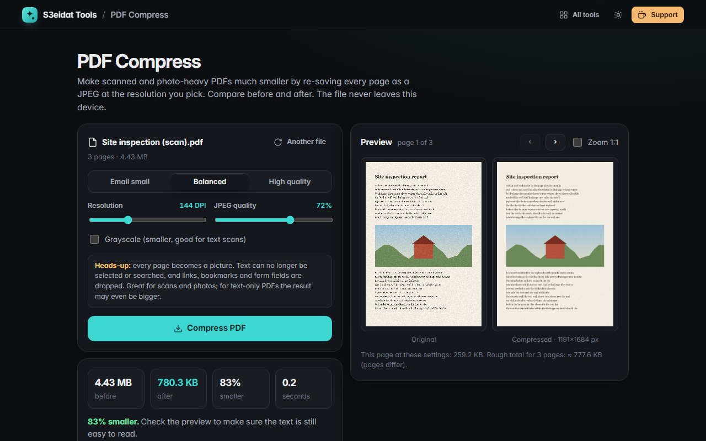

# PDF Compress

> Make scanned PDFs much smaller. Pick a resolution and JPEG quality, compare before and after, download. Free, private, and it runs entirely in your browser.

### ▶ [Open PDF Compress](https://s3eidat.github.io/pdf-compress/)



## Features

- Presets: **Email small** (96 DPI), **Balanced** (144 DPI), **High quality** (220 DPI), or set your own resolution (72–300 DPI) and JPEG quality (30–95%)
- **Grayscale** option for text scans
- **Before / after preview** of any page, with a 1:1 zoom to check that small text is still readable, and a size estimate before you start
- Progress bar and **cancel**
- Before and after sizes; if the result is **bigger than the original** it says so and offers the original instead
- Keeps every page at its original size (rotated pages come out upright)

## How it works, honestly

Every page is drawn as a picture at the resolution you choose and saved as a JPEG inside a new PDF. That's why it works so well on scans and photos, and why:

- text in the result is **not selectable or searchable** (it's part of the image),
- links, bookmarks, form fields and attachments are **not kept**,
- PDFs that are mostly text or vector drawings may get **bigger**. The tool tells you when that happens.

## Privacy

Your PDF never leaves your device. There is no server, no account, no analytics.
The page ships with a strict Content-Security-Policy (`connect-src 'self'`), so the browser
itself blocks any attempt to send data anywhere. Pages are drawn with [pdf.js](https://github.com/mozilla/pdf.js) (Apache-2.0)
and rebuilt with [pdf-lib](https://github.com/Hopding/pdf-lib) (MIT), both included in `lib/`.

## Run it yourself

It's plain HTML, CSS and JavaScript with no build step:

```bash
git clone https://github.com/s3eidat/pdf-compress
cd pdf-compress
python -m http.server 8000
```

Then open http://localhost:8000.

## Support

If this saved you time, **[buy me a coffee ☕](https://s3eidat.github.io/coffee/)**. It keeps every tool free.

---

Part of **[S3eidat Tools](https://s3eidat.github.io/)**: 100+ free, private tools that run in your browser. MIT licensed.
